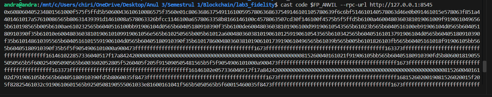
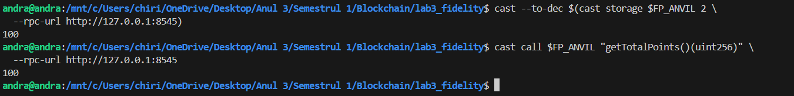
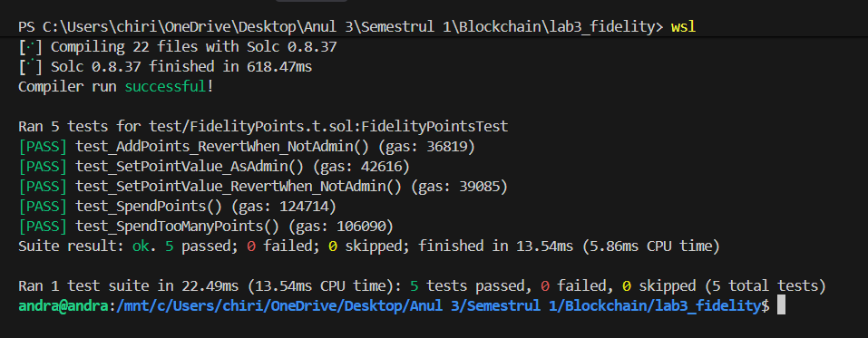
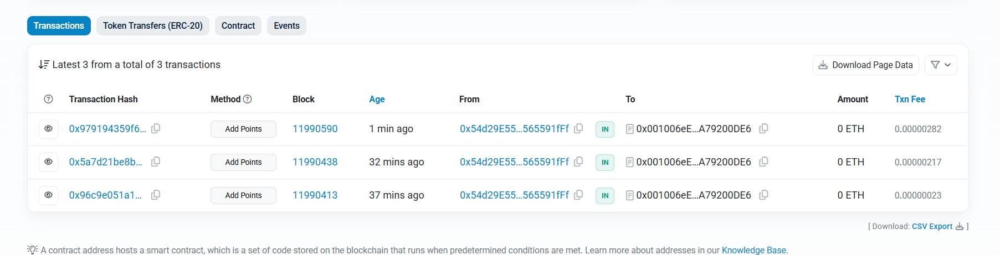
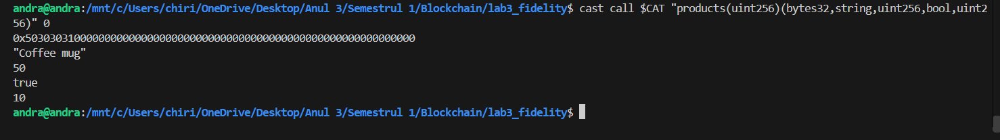
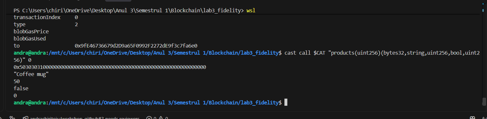
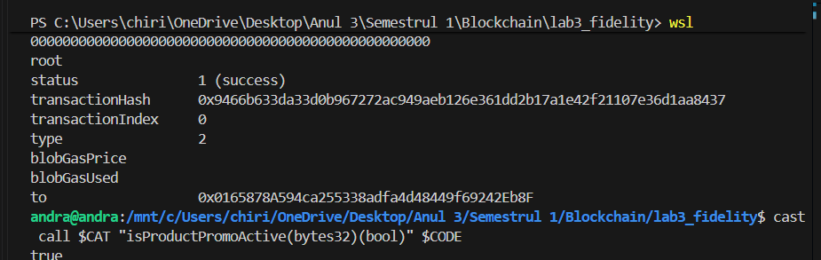
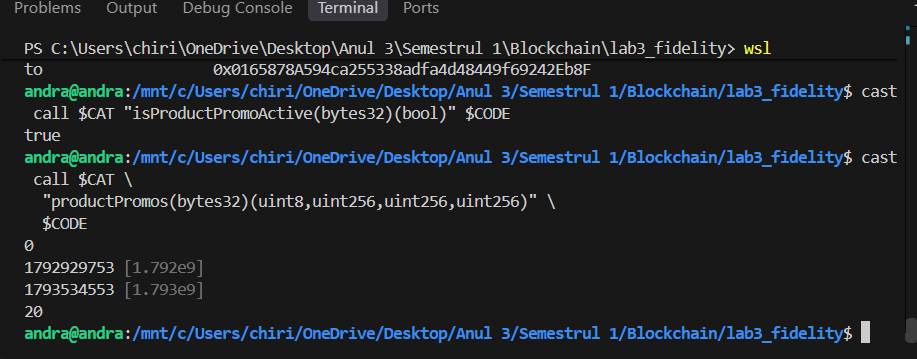
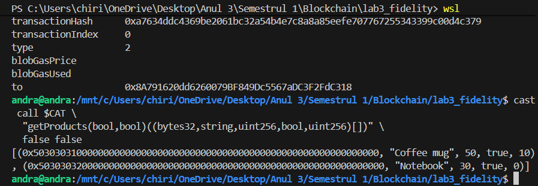
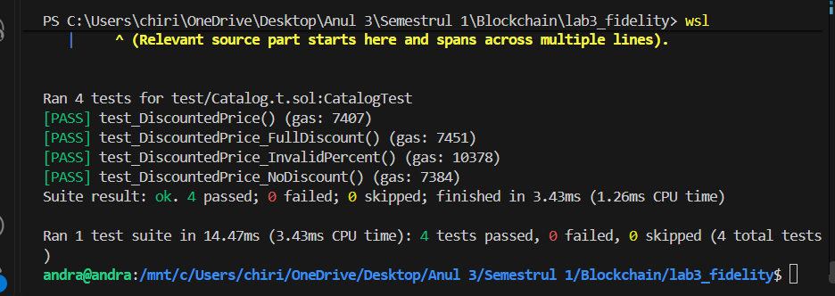

- Step 4 
Deploy pe Sepolia

Câmp	Valoare
Deployer	0x54d29E555D699110993eDD8871fe969565591fFf
Contract address	0x001006eE383Fb97Ec3FE4F53FB7506eA79200DE6
Transaction hash	0xcd27bc2e98544fdbf20e24580388ac38f43183e337ddb93c5c0946a8b1babe3f

=>https://sepolia.etherscan.io/address/0x001006eE383Fb97Ec3FE4F53FB7506eA79200DE6

- ex1 
Deploy local pe anvil

Deployer: 0xf39Fd6e51aad88F6F4ce6aB8827279cffFb92266
Deployed to: 0x5FbDB2315678afecb367f032d93F642f64180aa3
Transaction hash: 0x6a4bac44bca1f658228981482a5570f681ed7280af03f20d7720d10c4ee539f4

- ex2 

- ex3 

transactionHash      0x979194359f605f610bf7525ff1129173b819412ae194c90c95c5ea2af9971d65

- ex4 

Deploy la Catalog:
forge create src/Catalog.sol:Catalog \
  --rpc-url http://127.0.0.1:8545 \
  --private-key $ANVIL_KEY \
  --broadcast

Deployed to: 0x9fE46736679d2D9a65F0992F2272dE9f3c7fa6e0

increse

decrese

- ex5 

Deployed to: 0x0165878A594ca255338adfa4d48449f69242Eb8F

PROMOTIE ACTIVA

- ex6 

Deployed to: 0x8A791620dd6260079BF849Dc5567aDC3F2FdC318

- ex7 = calcularea pretului unui produs dupa aplicarea unei reduceri procentuale

