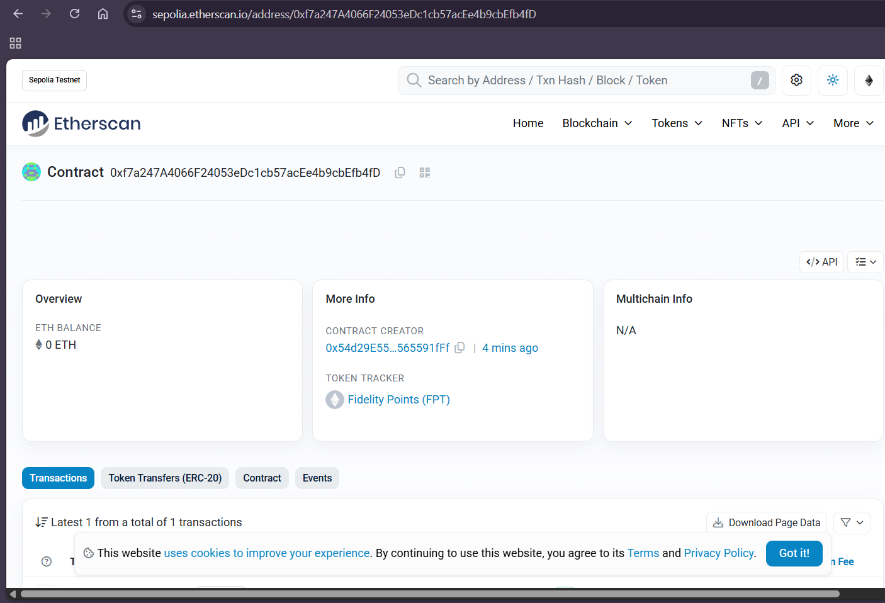
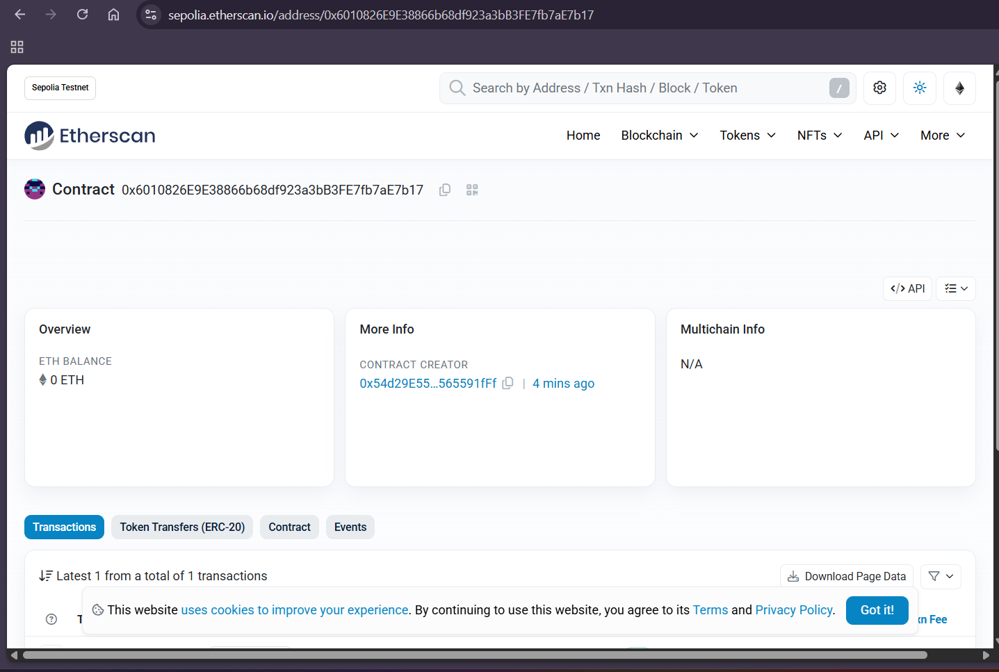
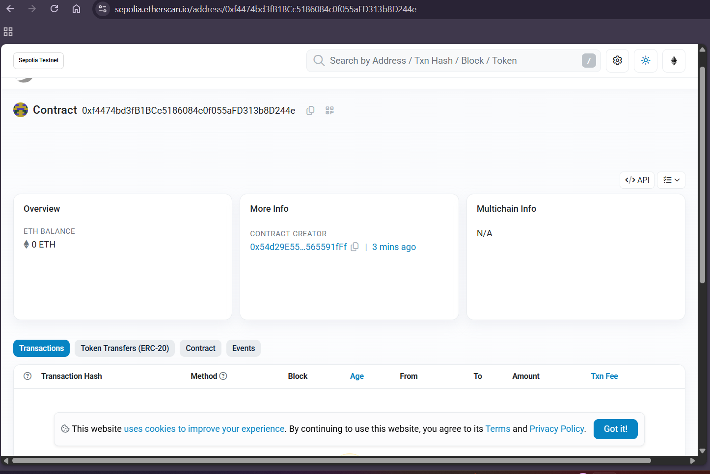
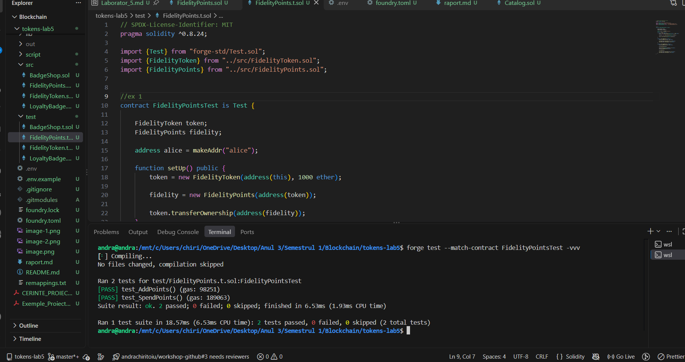
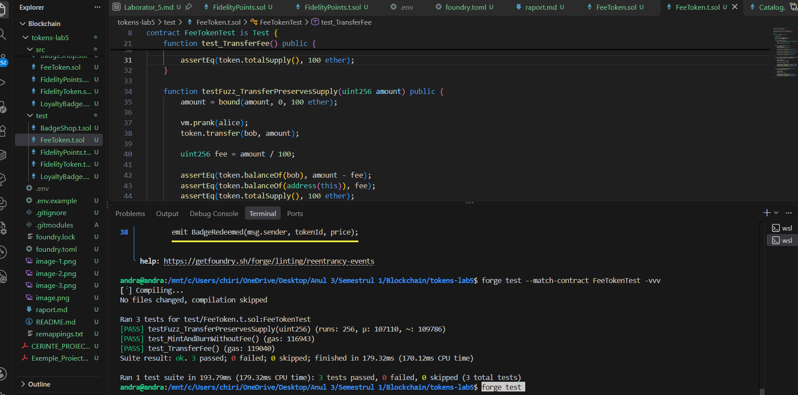

step 5 -> deploy sepolia

0x54d29E555D699110993eDD8871fe969565591fFf

0x54d29E555D699110993eDD8871fe969565591fFf

0x54d29E555D699110993eDD8871fe969565591fFf

- ex 1 -> punctele sa fie gestionate prin FidelityToken (ERC-20)

FidelityPoints.sol

FidelityPoints.t.sol

1. Ce funcții sau variabile nu mai sunt necesare?
- mapping(address => uint256) points – înlocuit cu balanceOf()
- totalPoints – înlocuit cu totalSupply()
- Logica manuală de actualizare a soldurilor – realizată de mint() și burnFrom()

2. Ce risc nou apare?
Înainte, punctele erau asociate unui client și nu puteau fi transferate.
Acum, fiind ERC-20, clienții pot trimite puncte altor clienți prin transfer().
De exemplu, cineva ar putea cumpăra puncte de la alt utilizator și obține beneficii de fidelitate fără să fi făcut cumpărături în magazin.

- ex 2 -> FeeToken cu taxă de transfer de 1%

FeeToken.sol

FeeToken.t.sol

