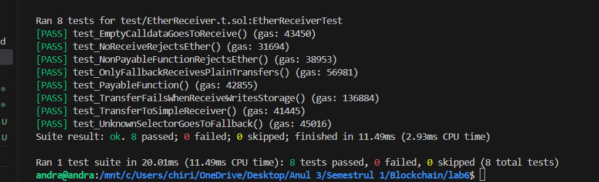
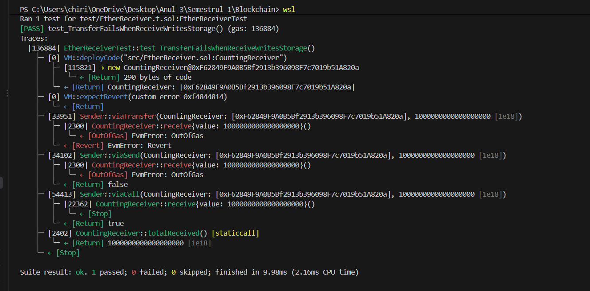
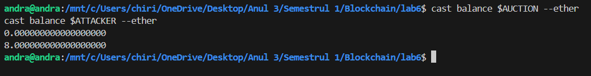
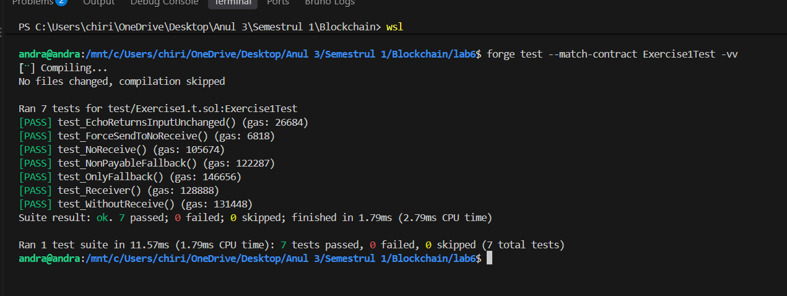
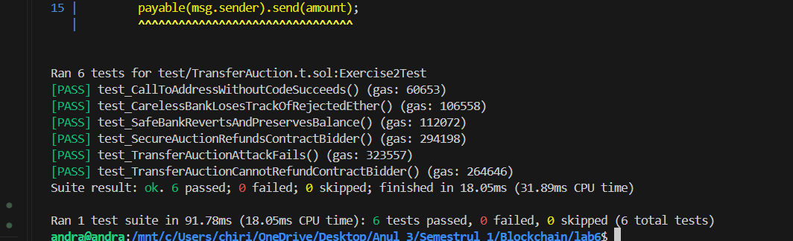
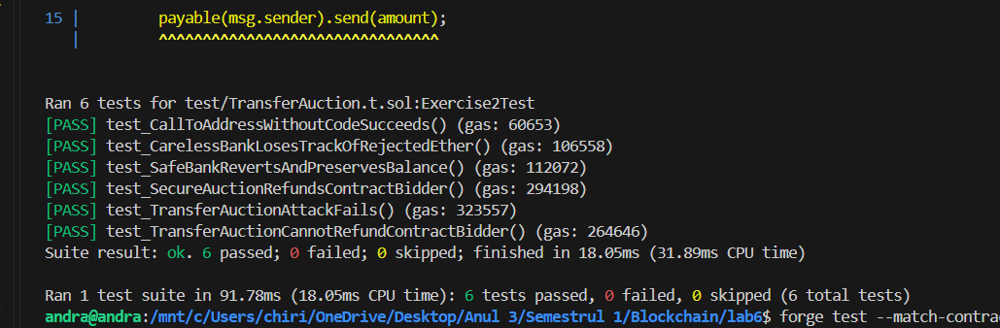
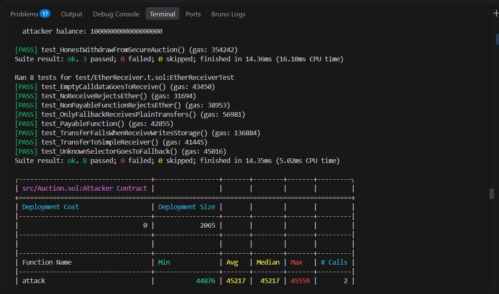
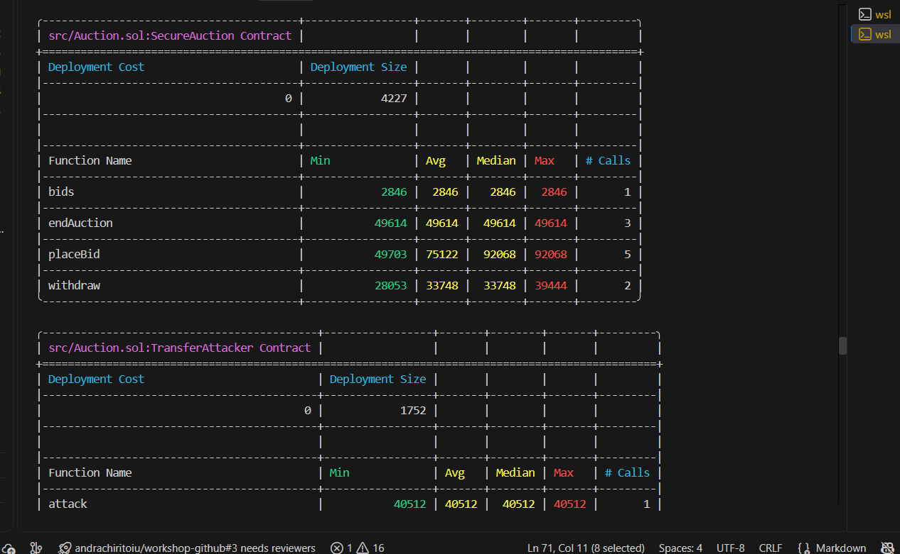
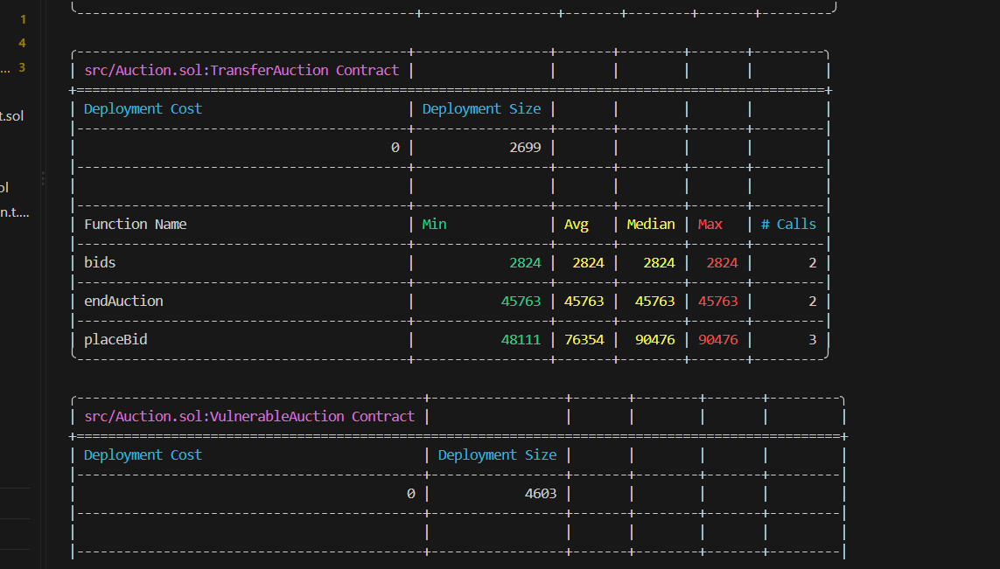
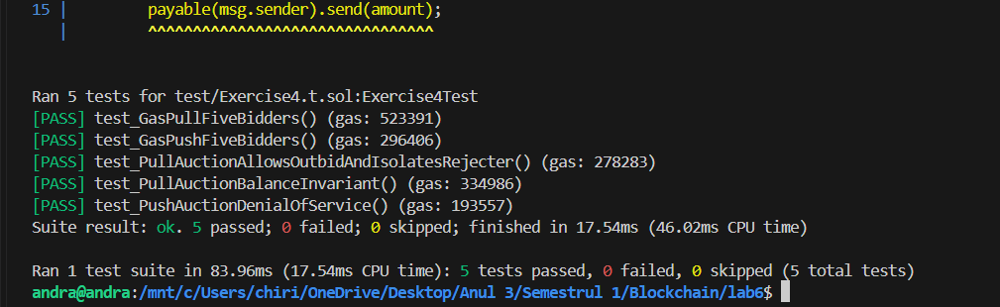

-step 2

-step3

-setp 4

-ex1

//1.1

| Contract | empty calldata, 0 wei | empty calldata, 1 ether | unknown selector, 0 wei | unknown selector, 1 ether |
|---|---|---|---|---|
| `Receiver` | `receive` | `receive` | `fallback` | `fallback` |
| `OnlyFallback` | `fallback` | `fallback` | `fallback` | `fallback` |
| `NoReceive` | revert | revert | revert | revert |
| `ReceiverWithoutReceive` | `fallback` | `fallback` | `fallback` | `fallback` |
| `ReceiverNonPayableFallback` | `receive` | `receive` | `fallback` | revert |

//1.3
Compilatorul avertizează cu warning-ul **5159** că `selfdestruct` este
deprecated și că, după Cancun/EIP-6780, în mod normal nu mai șterge codul și storage-ul,
ci transferă etherul.

//1.4

Warning-ul **3628** pentru `OnlyFallback` și pentru versiunea inițială a lui `Attacker`
spune că există un fallback `payable`, dar nu există `receive`. 

-ex2

Atacul re-entrancy nu reușește deoarece `transfer()` oferă doar 2300 gas, insuficient pentru ca atacatorul să apeleze din nou `withdraw()`. În trace apare eroarea `OutOfGas`.

Totuși, `transfer()` nu este o soluție recomandată, deoarece poate bloca și retragerile legitime. Soluția corectă este folosirea `call()` împreună cu *Checks–Effects–Interactions*.

-ex3

//3.1
Cu Bob la 2.5 ether atacul încă reușește și extrage 8 ether
Condiția corectă este `balance >= bidInfo`, nu `bidInfo / 5`

//3.2
`VulnerableAuction` permite două apeluri `claimPrize` și atacatorul primește 12 ether
`SecureAuction` actualizează `highestBid` înainte de transfer și permite un singur claim

//3.3
Modifierul `nonReentrant` folosește `bool transient locked` și `ReentrantCall`
Același guard blochează și re-intrarea din `withdraw` în `claimPrize`
Transient storage consumă mai puțin gas decât storage normal
Rulează comparația cu `forge test --gas-report`

-ex4

//4.1
În PushAuction Bob nu poate outbida MaliciousRejecter deoarece refundul eșuează
MaliciousRejecter rămâne câștigător

//4.2
PullAuction doar înregistrează refundul și permite următoarea ofertă
Doar MaliciousRejecter nu își poate retrage banii

//4.3
După `claim` soldul contractului este egal cu refundurile neretrase
`claim` și `withdraw` modifică starea înainte de transfer și nu pot plăti aceeași sumă de două ori

//4.4
În PushAuction bidderul plătește gasul refundului în tranzacția de bid
În PullAuction fiecare beneficiar plătește gasul pentru propria retragere
PullAuction evită DoS și reentrancy mai bine, dar este mai puțin comod pentru utilizator

