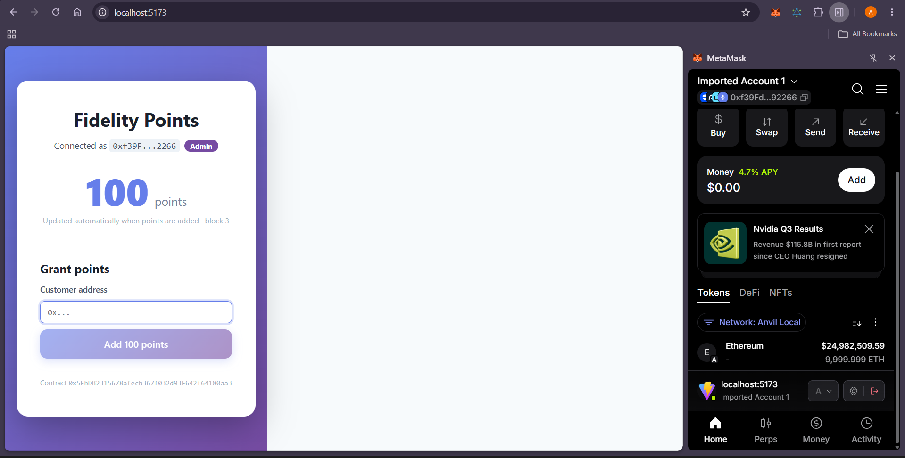
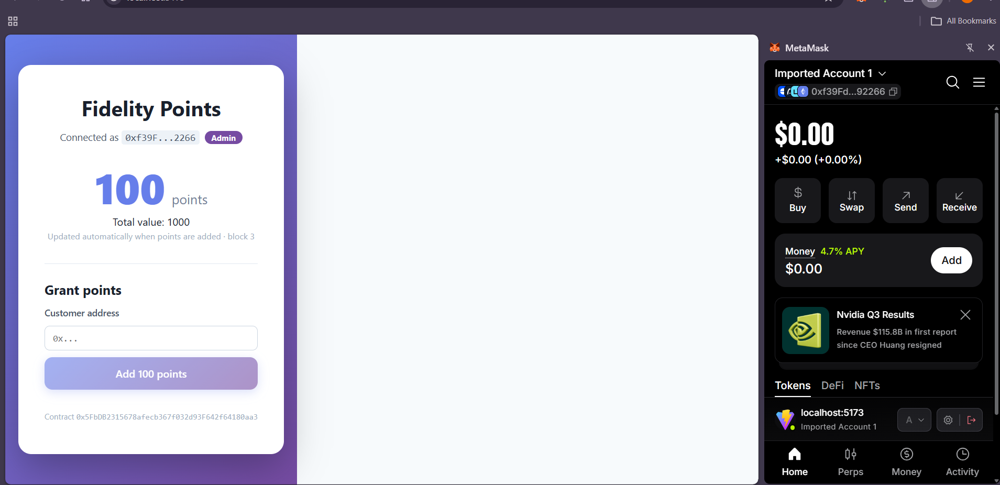
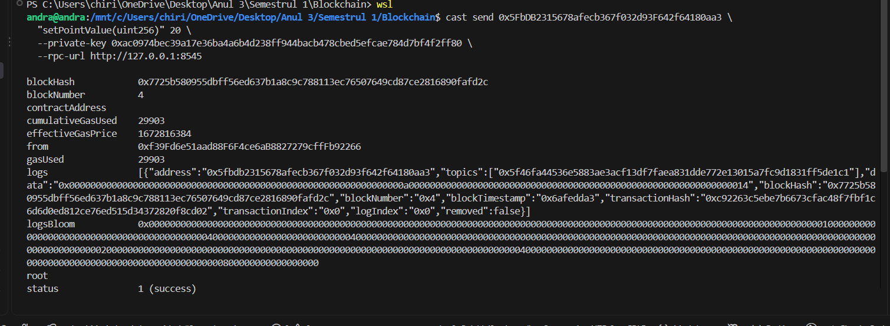
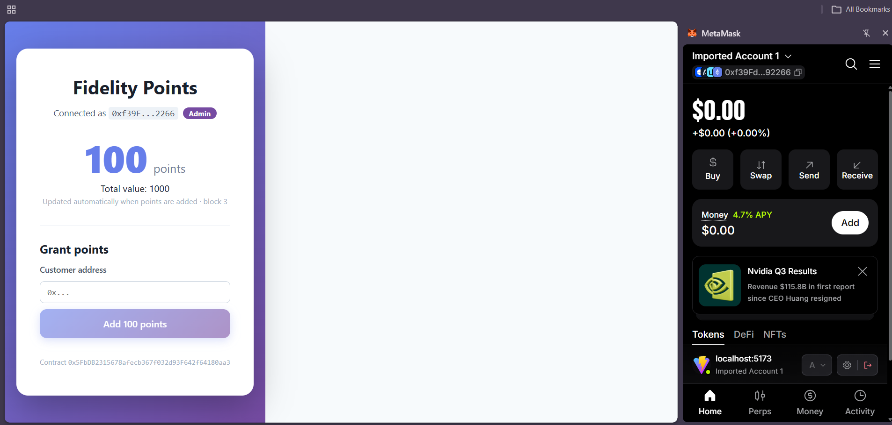
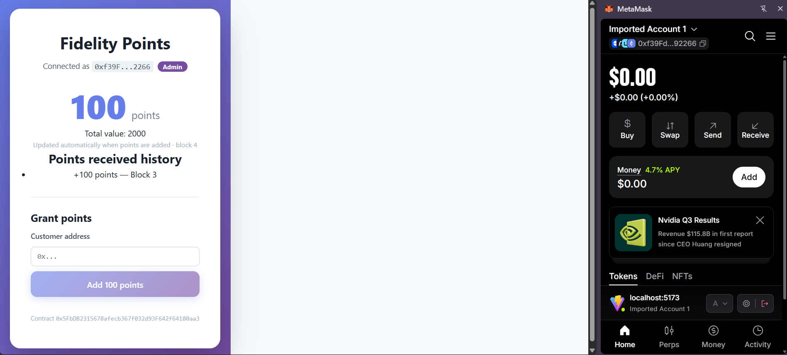
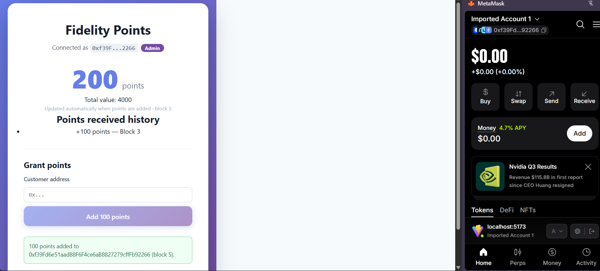
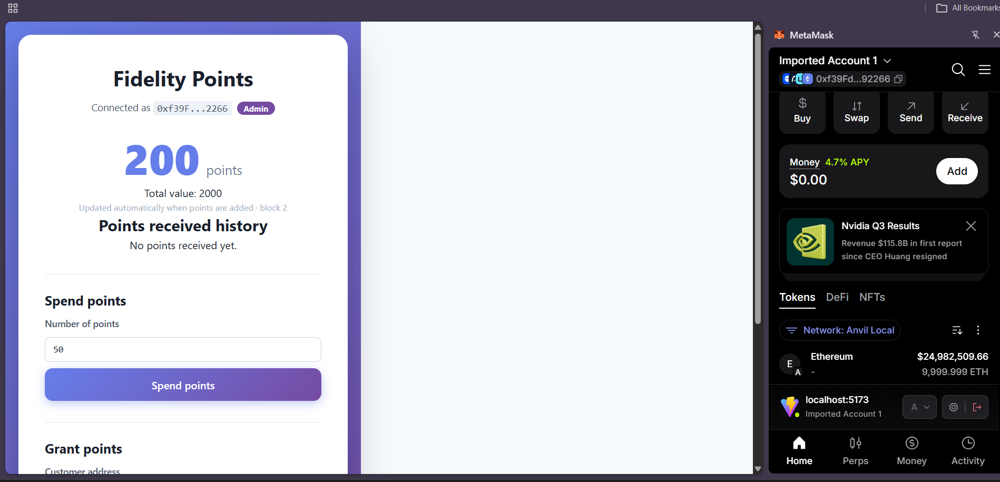
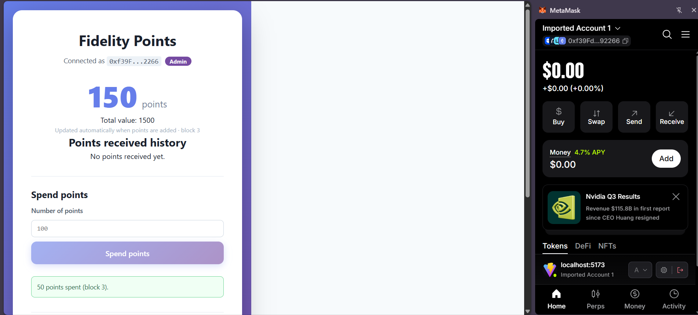
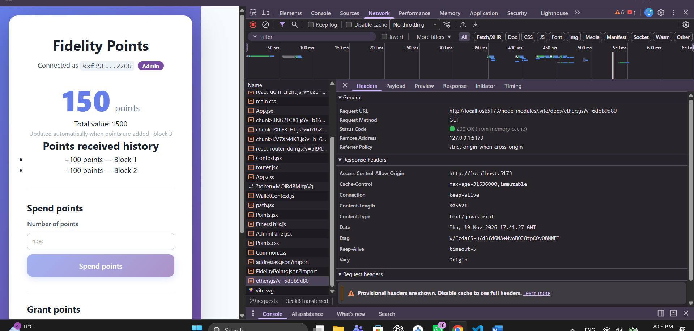

admin:  0xf39Fd6e51aad88F6F4ce6aB8827279cffFb92266

- ex 1 - valoarea punctelor

- ex 2 - istroicul punctelor primite

- mai adaugam 100 de puncte

- ex 3 - spend points

- ex 4 - eliminare contract.off()

Am comentat temporar `contract.off()` și am schimbat de mai multe ori conturile în MetaMask. Am urmărit cererile în Network, dar nu am putut observa direct acumularea cererilor `eth_getLogs`. Fără `contract.off()`, listener-ele vechi pot rămâne active, generând cereri inutile și procesări duplicate. De aceea, `contract.off()` este necesar pentru eliminarea listener-elor și gestionarea corectă a resurselor.